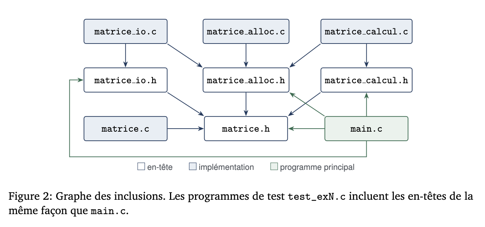

# Matrice_C
Tristan JEUILLARD [@trijeu](https://github.com/trijeu) --- Nicolas DI GRANDE [@ArchDGN](https://github.com/ArchDGN) --- TD3
remis le 23/10

# Compte rendu Implémentation des matrices

## Sommaire
- [Introduction](#introduction)
- [Conception de la bibliothèque](#Conception-de-la-bibliothèque)
- [Exercice 1 - Allocation et destruction](#Exercice-1)
- [Exercice 2 - Entrées sorties](#Exercice-2)
- [Exercice 3 - Calcul matriciel](#Exercice-3)
- [Exercice 4 - Démonstration complète](#Exercice-4)
- [Autres Scénarios](#Autres-Scénarios)
- [Bilan du projet](#bilan-et-difficultés)

## Introduction
Sujet: la création d'une bibliothèque (API) fonctionnelle en code C pour gérer des matrices sous forme textuelle dans des fichiers txt. La finalité est d'obtenir les fonctionnalités de création, lecture, affichage et sauvegarde des matrices tout en gérant les différents cas d'erreur. Ce projet est divisé en modules regroupant les interactions avec le système tel que la gestion en mémoire, le calcul ou les entrées - sorties. L'objectif est de savoir représenter et utiliser une structure similaire à une matrice en langage C, comprendre le principe de lecture écriture à partir d'un flux de données tout en évitant les fuites mémoires, et créer une bibliothèque C avec interfaces, implémentation puis compilation par édition de liens.

Notre avancée est la suivante: Les 4 exercices sont réalisés en intégralité, avec des tests d'utilisations corrects, et aucune fuite mémoire repérée. Ce repository contient par ailleur tous nos codes .h et .c modifiés.

## Conception de la bibliothèque:


### Règles de propriété de la mémoire retenues
R1: Toute variable Matrice est initialisée à MATRICE_VIDE dès sa déclaration.\
R2: Une fonction qui réussit (MAT_OK) et remplit *res transfère la propriété du résultat à l’appelant, qui devra appeler mat_detruire(&res).\
R3: Une fonction qui échoue laisse *res égal à MATRICE_VIDE et a libéré tout ce qu’elle avait alloué : l’appelant n’a rien à libérer.\
R4: Une fonction ne modifie et ne libère jamais une matrice reçue en entrée (const Matrice *).\
R5: *res est un paramètre de sortie : son ancien contenu est écrasé. S’il possédait de la mémoire, l’appelant doit l’avoir détruite avant l’appel. res doit être distinct des entrées.\
R6: mat_detruire remet la matrice à MATRICE_VIDE : un second appel est sans effet.\
R7: Un fichier est fermé par le code qui l’a ouvert. Les fonctions de matrice_io reçoivent un flux déjà ouvert et ne le ferment jamais.\

### Compilation:
Il est possible d'utiliser le fichier Makefile pour compiler la bibliothèque.
Compilation complète avec `-std=c11 -Wall -Wextra -Wpedantic -g` sans aucun avertissement :
```text
make clean && make
rm -f *.o demo_matrices test_ex1 test_ex2 test_ex3 test_ex2_sortie.txt
gcc -std=c11 -Wall -Wextra -Wpedantic -g main.c matrice.c matrice_alloc.c matrice_io.c matrice_calcul.c -o demo_matrices
gcc -std=c11 -Wall -Wextra -Wpedantic -g -DMAT_TEST_ALLOC test_ex1.c matrice.c matrice_alloc.c -o test_ex1
gcc -std=c11 -Wall -Wextra -Wpedantic -g -DMAT_TEST_ALLOC test_ex2.c matrice.c matrice_alloc.c matrice_io.c -o test_ex2
gcc -std=c11 -Wall -Wextra -Wpedantic -g -DMAT_TEST_ALLOC test_ex3.c matrice.c matrice_alloc.c matrice_calcul.c -o test_ex3
```

## Exercice 1:
### Code
```text
/* (1.a) */
    case MAT_ERR_DIMENSIONS: return "dimensions incompatibles";
    case MAT_ERR_DEPASSEMENT: return "resultat hors de l’intervalle des int";

/* (1.b) */
    return  m != NULL
            && m->coef != NULL
            && m->nb_lignes >= 1 && m->nb_lignes <= MAT_DIM_MAX
            && m->nb_colonnes >= 1 && m->nb_colonnes <= MAT_DIM_MAX;

/* (1.c) */
    if (nb_lignes < 1 || nb_lignes > MAT_DIM_MAX)
        return MAT_ERR_ARGUMENT;

    if (nb_colonnes < 1 || nb_colonnes > MAT_DIM_MAX)
        return MAT_ERR_ARGUMENT;

/* (1.d) */
    for (int i = 0; i < nb_lignes; i++) {
        coef[i] = mat_calloc((size_t)nb_colonnes, sizeof *coef[i]);    // nb_colonnes entiers
        if (coef[i] == NULL) {
            for (int k = i - 1; k >= 0; k--)  // lignes déjà
                free(coef[k]);                // obtenues
            free(coef);                       // puis le tableau
            return MAT_ERR_ALLOCATION;
        }
    }

/* (1.e) */
    res->coef = coef;
    res->nb_lignes = nb_lignes;
    res->nb_colonnes = nb_colonnes;

    return MAT_OK;

/* (1.f) */
    for (int j = 0 ; j < m->nb_lignes; j++)  // lignes déjà
        free(m->coef[j]);                // obtenues

    free(m->coef); 


    *m = MATRICE_VIDE;   /* FOURNI : état sûr après destruction (R6) */
```
### Execution
```text
valgrind --leak-check=full ./test_ex1
==3744== Memcheck, a memory error detector
==3744== Copyright (C) 2002-2024, and GNU GPL'd, by Julian Seward et al.
==3744== Using Valgrind-3.26.0 and LibVEX; rerun with -h for copyright info
==3744== Command: ./test_ex1
==3744== 
=== Exercice 1 : matrice.c ===
[OK]    (1.a) message pour MAT_ERR_DIMENSIONS
[OK]    (1.a) message pour MAT_ERR_DEPASSEMENT
[OK]    (1.b) une matrice 1 x 2 est valide
[OK]    (1.b) NULL n'est pas valide
[OK]    (1.b) MATRICE_VIDE n'est pas valide
[OK]    (1.b) une matrice de 0 ligne n'est pas valide
=== Exercice 1 : matrice_alloc.c ===
[OK]    (1.c) mat_allouer refuse 0 ligne
[OK]    (1.c) mat_allouer refuse -2 colonnes
[OK]    (1.c) mat_allouer refuse une dimension > MAT_DIM_MAX
[OK]    (1.e) mat_allouer(&m, 3, 4) renvoie MAT_OK
[OK]    (1.e) m a 3 lignes et 4 colonnes
[OK]    (1.d) tous les coefficients valent 0
[OK]    (1.f) apres mat_detruire, m est vide
[OK]    (1.f) un second mat_detruire est sans danger
[OK]    (1.f) mat_detruire(NULL) ne plante pas
=== Exercice 1 : echecs d'allocation simules ===
[OK]    (1.d) chaque echec renvoie MAT_ERR_ALLOCATION et laisse *res vide

Bilan : 16 / 16 verifications reussies.
Pensez a verifier l'absence de fuite : valgrind --leak-check=full ./test_ex1
==3744== 
==3744== HEAP SUMMARY:
==3744==     in use at exit: 0 bytes in 0 blocks
==3744==   total heap usage: 11 allocs, 11 frees, 1,228 bytes allocated
==3744== 
==3744== All heap blocks were freed -- no leaks are possible
==3744== 
==3744== For lists of detected and suppressed errors, rerun with: -s
==3744== ERROR SUMMARY: 0 errors from 0 contexts (suppressed: 0 from 0)
```

### Questions:
1.d) En cas d’échec lors de la réservation (lignes à NULL), on désalloue les lignes à partir de l’indice (atteint -1) puis la matrice complète.
coef -->\	
[ [ Ligne 0 ] ] --> Allouée, à libérer  free(coef[0]).\
[ [ Ligne 1 ] ] --> Allouée, à libérer  free(coef[1]).\
[ NULL ] <-- ÉCHEC à i = 2 rien alloué, arrêt de la boucle.\
[ ? ] <-- Non atteinte.\

Q3.1) Passer une matrice par valeur réalise une copie superficielle (le pointeur coef est dupliqué, pointant vers la même mémoire), ce qui rend les responsabilités de libération floues et empêche de remonter les erreurs. Par ailleurs, *free()* prend en paramètre une adresse pour bien effacer la variable pointée et non une copie.

Q3.2) Il faut N+1 appels à *calloc* et *free->* au total: un par ligne et le dernier pour la matrice elle-même. Si la k-ième allocation échoue (en numérotant les allocations de lignes de 1 à n), seules les lignes à partir de k ne sont pas allouées (donc null). Il faut donc libérer les lignes avant k, et la matrice elle-même donc (k-1) +1)) = k appels.

Q3.3) Appeler *free()* deux fois est indéterminé car on ne connaît pas la donnée au deuxième appel (donnée d’un autre programme). Dans *mat_detruire*, on termine l'appel par **m = MATRICE_VIDE*. Donc au deuxième appel la condition
*(m->coef!=NULL)* permet de ne pas appliquer le *free()* deux fois.
Une copie de matrice en C est superficielle, B pointe vers les mêmes champs que A, donc si on libère A, B garde ses pointeurs vers une donnée inconnue, ce qui crée un comportement indéfini.

Q3.4) On effectue l’affectation à la matrice nulle car une fonction qui échoue doit laisser *res à la matrice vide (dont les valeurs sont NULL) et libère les autres données. C’est la règle R3. Cela évite de rappeler *mat_detruire()* sur une donnée inconnue.

## Exercice 2:
### Code
```text
/* (2.a) */
    for (int i = 0; i < m->nb_lignes; i++) {
        for (int j = 0; j < m->nb_colonnes; j++)
            printf(" %8d", m->coef[i][j]);

        putchar('\n');
    }

/* (2.b) */
    for (int i = 0; i < m->nb_lignes; i++) {
        for (int j = 0; j < m->nb_colonnes; j++){
            if ((fprintf(f, j == 0 ? "%d" : " %d", m->coef[i][j])) < 0)
                return MAT_ERR_ECRITURE;
        }

        if ((fputc('\n', f)) == EOF)
            return MAT_ERR_ECRITURE;
    }

/* (2.c) */
    if (nb_lignes < 1 || nb_lignes > MAT_DIM_MAX)
        return MAT_ERR_FORMAT;

    if (nb_colonnes < 1 || nb_colonnes > MAT_DIM_MAX)
        return MAT_ERR_FORMAT;

// (2.d) À COMPLÉTER : déclarer une matrice LOCALE et l'allouer :
    Matrice tmp;
    err = mat_allouer(&tmp, nb_lignes, nb_colonnes);
    if (err != MAT_OK) 
        return err;

/* (2.e) */
    for (int i=0; i<nb_lignes; i++) {
        for (int j=0; j<nb_colonnes; j++) {
            err = lire_entier(f, &tmp.coef[i][j]);
            if (err != MAT_OK) {
                mat_detruire(&tmp);
                return err;
            }
        }
    }

// (2.f) À COMPLÉTER : tout a réussi, on transfère le résultat :
    *res = tmp;  
    return MAT_OK;
```
### Execution
```text
valgrind --leak-check=full ./test_ex2
==3754== Memcheck, a memory error detector
==3754== Copyright (C) 2002-2024, and GNU GPL'd, by Julian Seward et al.
==3754== Using Valgrind-3.26.0 and LibVEX; rerun with -h for copyright info
==3754== Command: ./test_ex2
==3754== 
=== Exercice 2 : affichage (verification visuelle) ===
M (4 x 3) :
        1        2        3
        4        5        6
        7        8        9
       10       11       12
(2.a) Vous devez voir ci-dessus 4 lignes : 1 2 3 / 4 5 6 / 7 8 9 / 10 11 12
=== Exercice 2 : ecriture ===
[OK]    ouverture de test_ex2_sortie.txt en ecriture
[OK]    (2.b) mat_ecrire renvoie MAT_OK
[OK]    (2.b) le fichier contient exactement le format attendu
[OK]    (2.b) mat_ecrire refuse une matrice vide
=== Exercice 2 : relecture ===
[OK]    (2.f) mat_lire relit le fichier : MAT_OK
[OK]    (2.e) la matrice relue est identique
[OK]    (2.e) espaces et sauts de ligne en trop sont toleres
=== Exercice 2 : fichiers incorrects ===
[OK]    (2.c) fichier vide
[OK]    (2.c) dimension nulle
[OK]    (2.c) dimension negative
[OK]    (2.e) coefficient manquant
[OK]    (2.e) donnee non numerique
[OK]    (2.e) entier trop grand pour un int
=== Exercice 2 : echec d'allocation simule ===
[OK]    (2.d) mat_lire renvoie MAT_ERR_ALLOCATION proprement

Bilan : 14 / 14 verifications reussies.
Pensez a verifier l'absence de fuite : valgrind --leak-check=full ./test_ex2
==3754== 
==3754== HEAP SUMMARY:
==3754==     in use at exit: 0 bytes in 0 blocks
==3754==   total heap usage: 51 allocs, 51 frees, 60,728 bytes allocated
==3754== 
==3754== All heap blocks were freed -- no leaks are possible
==3754== 
==3754== For lists of detected and suppressed errors, rerun with: -s
==3754== ERROR SUMMARY: 0 errors from 0 contexts (suppressed: 0 from 0)
```
### Questions
Q4.1) La fonction *mat_lire()* remplit *tmp*, une variable locale, et non **res* directement : si une erreur survient au milieu du fichier, l’appelant ne recevra jamais une matrice à moitié remplie donc incorrecte, mais bien une matrice nulle.

Q4.2) La lecture ne vérifie pas que chaque ligne de texte correspond à une ligne de la matrice. Cela n’est pas gênant car on applique le principe “tolérant en lecture, strict en écriture” soit tolérant sur les espaces, tabulations ou sauts de lignes via *scanf* pour des fichiers écrits manuellement, mais on devient strict pour respecter le format canonique en écriture.

Q4.3) En fin de fonction *mat_lire*, le flux pointe toujours vers le dernier coefficient lu. On peut donc suivre directement sur un autre appel de *mat_lire* sur le flux pour lire séquentiellement une autre matrice.

Q4.4) L’instruction *flush* permet de vider le buffer de la mémoire vers le fichier en écriture. Cela est également effectué par *fclose* mais il est plus juste de faire cette opération manuellement.

## Exercice 3:
### Code
```text

/* (3.a) */
    if (a->nb_lignes != b->nb_lignes)
        return MAT_ERR_DIMENSIONS;
    if (a->nb_colonnes != b->nb_colonnes)
        return MAT_ERR_DIMENSIONS;

/* (3.b) */
    Matrice r = MATRICE_VIDE;
    err = mat_allouer(&r, a->nb_lignes, a->nb_colonnes);
    if (err != MAT_OK)
        return err;

/* (3.c) */
    long long s = (long long)a->coef[i][j] + b->coef[i][j];

// (3.d) À COMPLÉTER : transférer le résultat :
    *res = r;  
    return MAT_OK;

/* (3.e) */
    if (a->nb_colonnes != b->nb_lignes)
        return MAT_ERR_DIMENSIONS;

/* (3.f) */
    Matrice r = MATRICE_VIDE;
    err = mat_allouer(&r, a->nb_lignes, b->nb_colonnes);
    if (err != MAT_OK)
        return err;

// (3.g) À COMPLÉTER : boucle sur k, de 0 à a->nb_colonnes - 1, qui ajoute à s le produit a(i,k) x b(k,j) :
    for (int k = 0; k < a->nb_colonnes; k++) {
        long long p = (long long)a->coef[i][k] * b->coef[k][j];
        if ((p > 0 && s > LLONG_MAX - p)
            || (p < 0 && s < LLONG_MIN - p)) {
            mat_detruire(&r);
            return MAT_ERR_DEPASSEMENT;
        }
        s += p;
    }

/* (3.h) À COMPLÉTER : *res = r;  return MAT_OK;                    */
    *res = r;  
    return MAT_OK;
```
### Execution

```text
valgrind --leak-check=full ./test_ex3
==3764== Memcheck, a memory error detector
==3764== Copyright (C) 2002-2024, and GNU GPL'd, by Julian Seward et al.
==3764== Using Valgrind-3.26.0 and LibVEX; rerun with -h for copyright info
==3764== Command: ./test_ex3
==3764==
=== Exercice 3 : addition ===
[OK]    (3.a) (2 x 3) + (3 x 2) : MAT_ERR_DIMENSIONS
[OK]    (3.d) (2 x 3) + (2 x 3) : MAT_OK
[OK]    (3.c) a + b est correct
[OK]    a et b n'ont pas ete modifiees
[OK]    (3.b) le resultat possede sa propre memoire
[OK]    (3.c) INT_MAX + 1 : MAT_ERR_DEPASSEMENT
=== Exercice 3 : multiplication ===
[OK]    (3.e) (2 x 3) x (2 x 3) : MAT_ERR_DIMENSIONS
[OK]    (3.h) (2 x 3) x (3 x 2) : MAT_OK
[OK]    (3.g) a x c = (58 64 / 139 154)
[OK]    (3.f) (3 x 2) x (2 x 3) donne une matrice 3 x 3
[OK]    a et c n'ont pas ete modifiees
[OK]    (3.g) 2 x 10^10 depasse INT_MAX : MAT_ERR_DEPASSEMENT
=== Exercice 3 : cas particuliers ===
[OK]    resultat = entree refuse, a reste intacte
[OK]    (3.f) echec d'allocation : MAT_ERR_ALLOCATION, r vide

Bilan : 14 / 14 verifications reussies.
Pensez a verifier l'absence de fuite : valgrind --leak-check=full ./test_ex3
==3764==
==3764== HEAP SUMMARY:
==3764==     in use at exit: 0 bytes in 0 blocks
==3764==   total heap usage: 37 allocs, 37 frees, 1,412 bytes allocated
==3764==
==3764== All heap blocks were freed -- no leaks are possible
==3764==
==3764== For lists of detected and suppressed errors, rerun with: -s
==3764== ERROR SUMMARY: 0 errors from 0 contexts (suppressed: 0 from 0)
```
### Questions
Q5.1) Le préfixe const évite de modifier l’adresse des attributs de la matrice A lors des calculs, mais pas la valeur des coefficients pointés. Pour protéger les coeffs de A il faudrait passer toutes les lignes *int*** en *const*.

Q5.2) Interdire l’alias *(mat_additionner(&a, &b, &a)* évite de modifier les données de A pendant le calcul en suivant les règles R3 / R5 en cas d’échec.

Q5.3) Pour deux matrices de taille (n,p) et (p,q) il faut n*p*q multiplications d’entiers pour effectuer le produit matriciel. Avec des matrices carrées de taille 1000, il en faut 1000^3 soit 10^9.

Q5.4) Si *(coef(a) + coef(b) > long long)*, on a une erreur de dépassement qui n’est pas repérée par s < a .

## Exercice 4:
### Code
```text

/* (4.a) À COMPLÉTER : afficher A et B avec mat_afficher.          */
    mat_afficher("A", &a);
    mat_afficher("B", &b);

/* (4.b) */
    MatErreur err = addition ? mat_additionner(&a, &b, &r) : mat_multiplier(&a, &b, &r);
    if (err != MAT_OK) {
        fprintf(stderr, "Erreur : calcul impossible : %s ",
        mat_message_erreur(err));
        fprintf(stderr, "(A : %d x %d, B : %d x %d)\n", a.nb_lignes, a.nb_colonnes, b.nb_lignes, b.nb_colonnes);
        goto nettoyage;
    }

/* (4.c) À COMPLÉTER : afficher r (nom "R = A + B" ou "R = A x B").  */
    addition ? mat_afficher("R = A + B", &r) : mat_afficher("R = A x B", &r);

/* (4.d) */
    printf("Résultat enregistré dans \"%s\".\n", argv[4]);

    statut = EXIT_SUCCESS;
```
### Execution
### Scénario 1 : `add A.txt B.txt R.txt`
**Comportement attendu :** affiche $A$, $B$, $R$ ; `R.txt` créé au format canonique (Sortie : `0`).

```text
valgrind --leak-check=full ./demo_matrices add donnees/A.txt donnees/B.txt R.txt
echo "Code de sortie : $?"
cat R.txt
==3774== Memcheck, a memory error detector
==3774== Copyright (C) 2002-2024, and GNU GPL'd, by Julian Seward et al.
==3774== Using Valgrind-3.26.0 and LibVEX; rerun with -h for copyright info
==3774== Command: ./demo_matrices add donnees/A.txt donnees/B.txt R.txt
==3774== 
A (4 x 3) :
       25       48       84
       15       33       11
       45       88       10
        0       12       -5
B (4 x 3) :
        1        2        3
        4        5        6
        7        8        9
       10       11       12
R = A + B (4 x 3) :
       26       50       87
       19       38       17
       52       96       19
       10       23        7
Résultat enregistré dans "R.txt".
==3774== 
==3774== HEAP SUMMARY:
==3774==     in use at exit: 0 bytes in 0 blocks
==3774==   total heap usage: 22 allocs, 22 frees, 14,968 bytes allocated
==3774== 
==3774== All heap blocks were freed -- no leaks are possible
==3774== 
==3774== For lists of detected and suppressed errors, rerun with: -s
==3774== ERROR SUMMARY: 0 errors from 0 contexts (suppressed: 0 from 0)
Code de sortie : 0
4 3
26 50 87
19 38 17
52 96 19
10 23 7
```

### Critère de validation supplémentaire (6.7) : Relecture du fichier généré (`add R.txt R.txt R2.txt`)
**Comportement attendu :** le fichier `R.txt` produit par le scénario 1 peut être relu par le programme lui-même (Sortie : `0`).

```text
valgrind --leak-check=full ./demo_matrices add R.txt R.txt R2.txt
echo "Code de sortie : $?"
==3795== Memcheck, a memory error detector
==3795== Copyright (C) 2002-2024, and GNU GPL'd, by Julian Seward et al.
==3795== Using Valgrind-3.26.0 and LibVEX; rerun with -h for copyright info
==3795== Command: ./demo_matrices add R.txt R.txt R2.txt
==3795==
A (4 x 3) :
       26       50       87
       19       38       17
       52       96       19
       10       23        7
B (4 x 3) :
       26       50       87
       19       38       17
       52       96       19
       10       23        7
R = A + B (4 x 3) :
       52      100      174
       38       76       34
      104      192       38
       20       46       14
Résultat enregistré dans "R2.txt".
==3795==
==3795== HEAP SUMMARY:
==3795==     in use at exit: 0 bytes in 0 blocks
==3795==   total heap usage: 22 allocs, 22 frees, 14,968 bytes allocated
==3795==
==3795== All heap blocks were freed -- no leaks are possible
==3795==
==3795== For lists of detected and suppressed errors, rerun with: -s
==3795== ERROR SUMMARY: 0 errors from 0 contexts (suppressed: 0 from 0)
Code de sortie : 0
```
### Questions
Q6.1) On découple la gestion des erreurs et de l’affichage. Ainsi main est le programme principal qui peut donc être connecté à une interface graphique logicielle. On rend la bibliothèque indépendante.

Q6.2) Le test de *fclose* en écriture sert à valider que les tampons (buffers) en mémoire ont bien été vidés sur le disque (détection de disque plein), une vérification inutile en lecture car aucun buffer n’est utilisé. 

Q6.3) Dans le scénario 8, si l'enregistrement échoue après un calcul réussi, la matrice R a bien été allouée et il faut donc libérer 3 matrices -> A, B et R. Le *goto nettoyage* s’en charge correctement. 

## Autres Scénarios
* [Scénario 2 : `mul A.txt C.txt R.txt`](#scénario-2--mul-atxt-ctxt-rtxt)
* [Scénario 3 : `add A.txt C.txt R.txt`](#scénario-3--add-atxt-ctxt-rtxt)
* [Scénario 4 : `mul A.txt B.txt R.txt`](#scénario-4--mul-atxt-btxt-rtxt)
* [Scénario 5 : Fichier `absent.txt`](#scénario-5--fichier-absenttxt)
* [Scénario 6 : `invalide.txt` comme A](#scénario-6--invalidetxt-comme-a)
* [Scénario 7 : `tronque.txt` comme A](#scénario-7--tronquetxt-comme-a)
* [Scénario 8 : Résultat dans un dossier inexistant](#scénario-8--résultat-dans-un-dossier-inexistant)
* [Scénario 10 : Arguments manquants ou opération inconnue](#scénario-10--arguments-manquants-ou-opération-inconnue)

## Bilan et difficultés
Nous avons compris l'importance de la modularisation afin d'avancer plus vite et en parallèle sur le code.
Lors de notre travail, nous avons travaillé ensemble sur le code depuis l'environnement de Nicolas afin d'avoir tous deux une bonne compréhension du sujet et de sa résolution. Nous avons ensuite divisé notre travail sur le compte rendu. Tristan a principalement rédigé le texte en introduction et conclusion, Nicolas a intégré les éléments de code ainsi que les diagrammes de la bibliothèque. Enfin nous avons répondu aux questions de compréhension ensemble pour garder un apprentissage complet sur le projet. Au final notre participation dans le projet aura été égale.
Pour nous aider dans la confection de ce compte rendu, le LLM Gemini Argon de Google nous a aidé à corriger la  mise en forme sous markdown qui nous était inconnu, ainsi que pour extraire des portions de code qui se situent plus haut. Nous avons priorisé notre apprentissage en code C et l'usage d'IA a donc été absent pendant la phase de développement.
\
\
\
## Scénarios supplémentaires:
### Scénario 2 : `mul A.txt C.txt R.txt`
**Comportement attendu :** affiche $A$, $B$, $R$ de dimensions $4 \times 2$ ; `R.txt` créé au format canonique (Sortie : `0`).

```text
valgrind --leak-check=full ./demo_matrices mul donnees/A.txt donnees/C.txt R.txt
echo "Code de sortie : $?"
==3810== Memcheck, a memory error detector
==3764== Copyright (C) 2002-2024, and GNU GPL'd, by Julian Seward et al.
==3810== Using Valgrind-3.26.0 and LibVEX; rerun with -h for copyright info
==3810== Command: ./demo_matrices mul donnees/A.txt donnees/C.txt R.txt
==3810==
A (4 x 3) :
       25       48       84
       15       33       11
       45       88       10
        0       12       -5
B (3 x 2) :
        1        0
        0        1
        2       -1
R = A x B (4 x 2) :
      193      -36
       37       22
       65       78
      -10       17
Résultat enregistré dans "R.txt".
==3810==
==3810== HEAP SUMMARY:
==3810==     in use at exit: 0 bytes in 0 blocks
==3810==   total heap usage: 21 allocs, 21 frees, 14,920 bytes allocated
==3810==
==3810== All heap blocks were freed -- no leaks are possible
==3810==
==3810== For lists of detected and suppressed errors, rerun with: -s
==3810== ERROR SUMMARY: 0 errors from 0 contexts (suppressed: 0 from 0)
Code de sortie : 0
```

### Scénario 3 : `add A.txt C.txt R.txt`
**Comportement attendu :** « dimensions incompatibles », avec les dimensions ; pas de fichier créé (Sortie : `1`).

```text
rm -f R.txt R2.txt
valgrind --leak-check=full ./demo_matrices add donnees/A.txt donnees/C.txt R.txt
echo "Code de sortie : $?"
ls -l R.txt
==3831== Memcheck, a memory error detector
==3831== Copyright (C) 2002-2024, and GNU GPL'd, by Julian Seward et al.
==3831== Using Valgrind-3.26.0 and LibVEX; rerun with -h for copyright info
==3831== Command: ./demo_matrices add donnees/A.txt donnees/C.txt R.txt
==3831==
A (4 x 3) :
       25       48       84
       15       33       11
       45       88       10
        0       12       -5
B (3 x 2) :
        1        0
        0        1
        2       -1
Erreur : calcul impossible : dimensions incompatibles (A : 4 x 3, B : 3 x 2)
==3831==
==3831== HEAP SUMMARY:
==3831==     in use at exit: 0 bytes in 0 blocks
==3831==   total heap usage: 14 allocs, 14 frees, 10,288 bytes allocated
==3831==
==3831== All heap blocks were freed -- no leaks are possible
==3831== 
==3831== For lists of detected and suppressed errors, rerun with: -s
==3831== ERROR SUMMARY: 0 errors from 0 contexts (suppressed: 0 from 0)
Code de sortie : 1
ls: cannot access 'R.txt': No such file or directory
```

### Scénario 4 : `mul A.txt B.txt R.txt`
**Comportement attendu :** « dimensions incompatibles », avec les dimensions ($4 \times 3$ par $4 \times 3$) ; pas de fichier créé (Sortie : `1`).

```text
valgrind --leak-check=full ./demo_matrices mul donnees/A.txt donnees/B.txt R.txt
echo "Code de sortie : $?"
==3852== Memcheck, a memory error detector
==3852== Copyright (C) 2002-2024, and GNU GPL'd, by Julian Seward et al.
==3852== Using Valgrind-3.26.0 and LibVEX; rerun with -h for copyright info
==3852== Command: ./demo_matrices mul donnees/A.txt donnees/B.txt R.txt
==3852==
A (4 x 3) :
       25       48       84
       15       33       11
       45       88       10
        0       12       -5
B (4 x 3) :
        1        2        3
        4        5        6
        7        8        9
       10       11       12
Erreur : calcul impossible : dimensions incompatibles (A : 4 x 3, B : 4 x 3)
==3852==
==3852== HEAP SUMMARY:
==3852==     in use at exit: 0 bytes in 0 blocks
==3852==   total heap usage: 15 allocs, 15 frees, 10,320 bytes allocated
==3852==
==3852== All heap blocks were freed -- no leaks are possible
==3852==
==3852== For lists of detected and suppressed errors, rerun with: -s
==3852== ERROR SUMMARY: 0 errors from 0 contexts (suppressed: 0 from 0)
Code de sortie : 1
```

### Scénario 5 : Fichier `absent.txt`
**Comportement attendu :** « impossible d'ouvrir » + cause système (Sortie : `1`).

```text
valgrind --leak-check=full ./demo_matrices add donnees/absent.txt donnees/B.txt R.txt
echo "Code de sortie : $?"
==3867== Memcheck, a memory error detector
==3867== Copyright (C) 2002-2024, and GNU GPL'd, by Julian Seward et al.
==3867== Using Valgrind-3.26.0 and LibVEX; rerun with -h for copyright info
==3867== Command: ./demo_matrices add donnees/absent.txt donnees/B.txt R.txt
==3867==
Erreur : impossible d'ouvrir "donnees/absent.txt" : No such file or directory
==3867==
==3867== HEAP SUMMARY:
==3867==     in use at exit: 0 bytes in 0 blocks
==3867==   total heap usage: 3 allocs, 3 frees, 494 bytes allocated
==3867==
==3867== All heap blocks were freed -- no leaks are possible
==3867== 
==3867== For lists of detected and suppressed errors, rerun with: -s
==3867== ERROR SUMMARY: 0 errors from 0 contexts (suppressed: 0 from 0)
Code de sortie : 1
```

### Scénario 6 : `invalide.txt` comme $A$
**Comportement attendu :** « fichier mal formé », avec le nom du fichier (Sortie : `1`).

```text
valgrind --leak-check=full ./demo_matrices add donnees/invalide.txt donnees/B.txt R.txt
echo "Code de sortie : $?"
==3882== Memcheck, a memory error detector
==3882== Copyright (C) 2002-2024, and GNU GPL'd, by Julian Seward et al.
==3882== Using Valgrind-3.26.0 and LibVEX; rerun with -h for copyright info
==3882== Command: ./demo_matrices add donnees/invalide.txt donnees/B.txt R.txt
==3882==
Erreur : lecture de "donnees/invalide.txt" : fichier mal formé
==3882== 
==3882== HEAP SUMMARY:
==3882==     in use at exit: 0 bytes in 0 blocks
==3882==   total heap usage: 5 allocs, 5 frees, 4,600 bytes allocated
==3882== 
==3882== All heap blocks were freed -- no leaks are possible
==3882==
==3882== For lists of detected and suppressed errors, rerun with: -s
==3882== ERROR SUMMARY: 0 errors from 0 contexts (suppressed: 0 from 0)
Code de sortie : 1
```

### Scénario 7 : `tronque.txt` comme $A$
**Comportement attendu :** « fichier mal formé » (Sortie : `1`).

```text
valgrind --leak-check=full ./demo_matrices add donnees/tronque.txt donnees/B.txt R.txt
echo "Code de sortie : $?"
==3897== Memcheck, a memory error detector
==3897== Copyright (C) 2002-2024, and GNU GPL'd, by Julian Seward et al.
==3897== Using Valgrind-3.26.0 and LibVEX; rerun with -h for copyright info
==3897== Command: ./demo_matrices add donnees/tronque.txt donnees/B.txt R.txt
==3897==
Erreur : lecture de "donnees/tronque.txt" : fichier mal formé
==3897==
==3897== HEAP SUMMARY:
==3897==     in use at exit: 0 bytes in 0 blocks
==3897==   total heap usage: 6 allocs, 6 frees, 4,628 bytes allocated
==3897==
==3897== All heap blocks were freed -- no leaks are possible
==3897==
==3897== For lists of detected and suppressed errors, rerun with: -s
==3897== ERROR SUMMARY: 0 errors from 0 contexts (suppressed: 0 from 0)
Code de sortie : 1
```

### Scénario 8 : Résultat dans un dossier inexistant
**Comportement attendu :** « impossible de créer » ; matrices libérées (Sortie : `1`).

```text
valgrind --leak-check=full ./demo_matrices add donnees/A.txt donnees/B.txt dossier_inexistant/R.txt
echo "Code de sortie : $?"
==3912== Memcheck, a memory error detector
==3912== Copyright (C) 2002-2024, and GNU GPL'd, by Julian Seward et al.
==3912== Using Valgrind-3.26.0 and LibVEX; rerun with -h for copyright info
==3912== Command: ./demo_matrices add donnees/A.txt donnees/B.txt dossier_inexistant/R.txt
==3912==
A (4 x 3) :
       25       48       84
       15       33       11
       45       88       10
        0       12       -5
B (4 x 3) :
        1        2        3
        4        5        6
        7        8        9
       10       11       12
R = A + B (4 x 3) :
       26       50       87
       19       38       17
       52       96       19
       10       23        7
Erreur : impossible de créer "dossier_inexistant/R.txt" : No such file or directory
==3912==
==3912== HEAP SUMMARY:
==3912==     in use at exit: 0 bytes in 0 blocks
==3912==   total heap usage: 23 allocs, 23 frees, 10,894 bytes allocated
==3912==
==3912== All heap blocks were freed -- no leaks are possible
==3912==
==3912== For lists of detected and suppressed errors, rerun with: -s
==3912== ERROR SUMMARY: 0 errors from 0 contexts (suppressed: 0 from 0)
Code de sortie : 1
```

### Scénario 10 : Arguments manquants ou opération inconnue
**Comportement attendu :** message d'usage (Sortie : `1`).

```text
# Test 10a : arguments manquants
valgrind --leak-check=full ./demo_matrices add donnees/A.txt
echo "Code de sortie : $?"
==3931== Memcheck, a memory error detector
==3931== Copyright (C) 2002-2024, and GNU GPL'd, by Julian Seward et al.
==3931== Using Valgrind-3.26.0 and LibVEX; rerun with -h for copyright info
==3931== Command: ./demo_matrices add donnees/A.txt
==3931== 
Usage : ./demo_matrices <add|mul> <fichier_A> <fichier_B> <fichier_R>
==3931== 
==3931== HEAP SUMMARY:
==3931==     in use at exit: 0 bytes in 0 blocks
==3931==   total heap usage: 0 allocs, 0 frees, 0 bytes allocated
==3931== 
==3931== All heap blocks were freed -- no leaks are possible
==3931== 
==3931== For lists of detected and suppressed errors, rerun with: -s
==3931== ERROR SUMMARY: 0 errors from 0 contexts (suppressed: 0 from 0)
Code de sortie : 1
```

```text
# Test 10b : opération inconnue ("sub" au lieu de "add" ou "mul")
valgrind --leak-check=full ./demo_matrices sub donnees/A.txt donnees/B.txt R.txt
echo "Code de sortie : $?"
==3946== Memcheck, a memory error detector
==3946== Copyright (C) 2002-2024, and GNU GPL'd, by Julian Seward et al.
==3946== Using Valgrind-3.26.0 and LibVEX; rerun with -h for copyright info
==3946== Command: ./demo_matrices sub donnees/A.txt donnees/B.txt R.txt
==3946== 
Usage : ./demo_matrices <add|mul> <fichier_A> <fichier_B> <fichier_R>
==3946== 
==3946== HEAP SUMMARY:
==3946==     in use at exit: 0 bytes in 0 blocks
==3946==   total heap usage: 0 allocs, 0 frees, 0 bytes allocated
==3946== 
==3946== All heap blocks were freed -- no leaks are possible
==3946== 
==3946== For lists of detected and suppressed errors, rerun with: -s
==3946== ERROR SUMMARY: 0 errors from 0 contexts (suppressed: 0 from 0)
Code de sortie : 1
```


